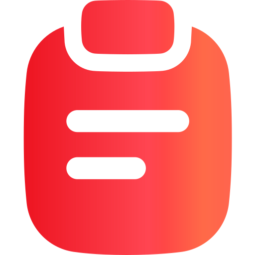
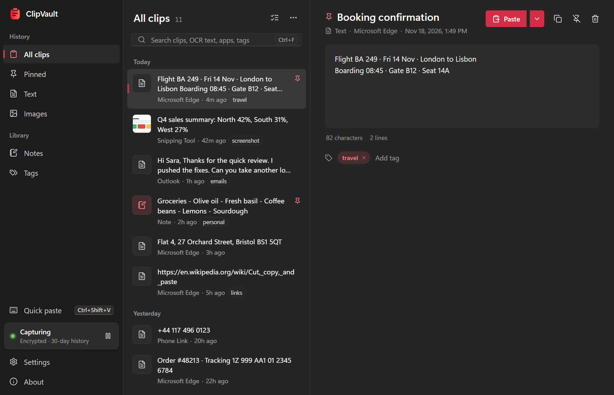
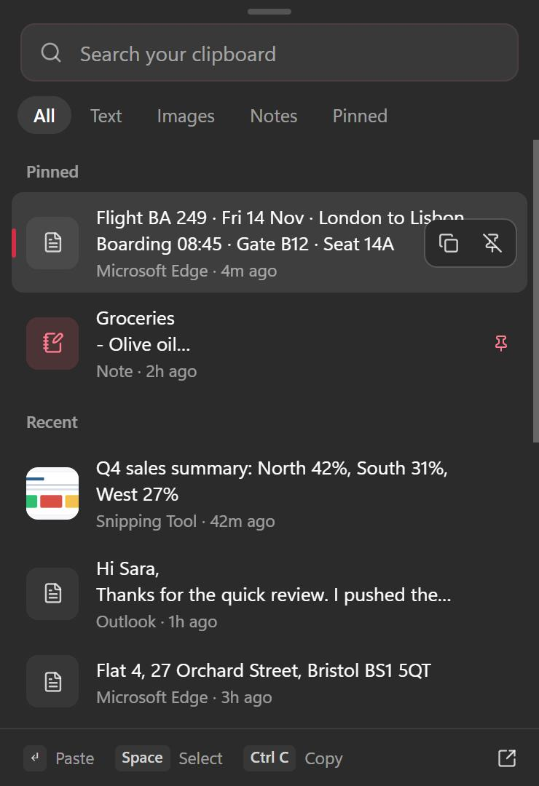
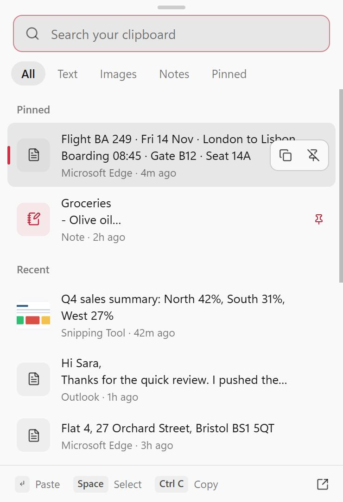
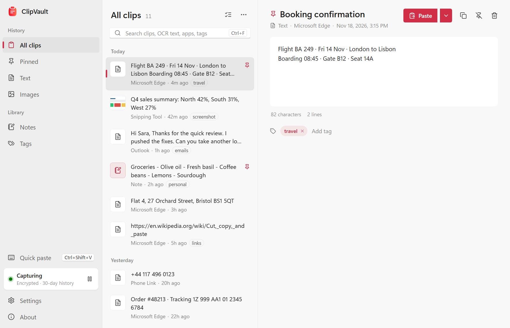
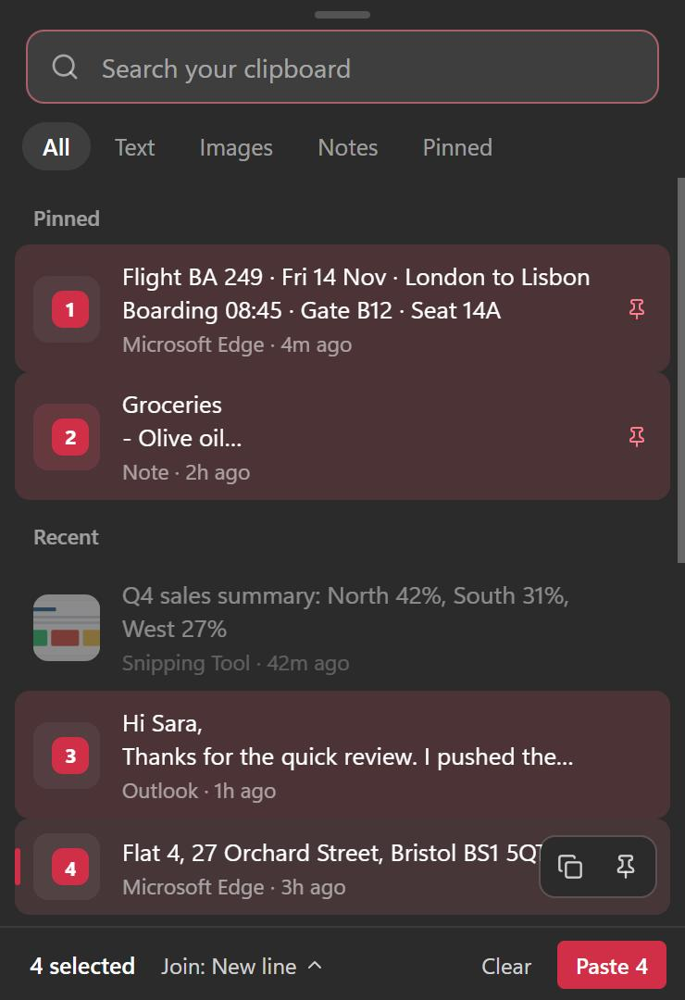
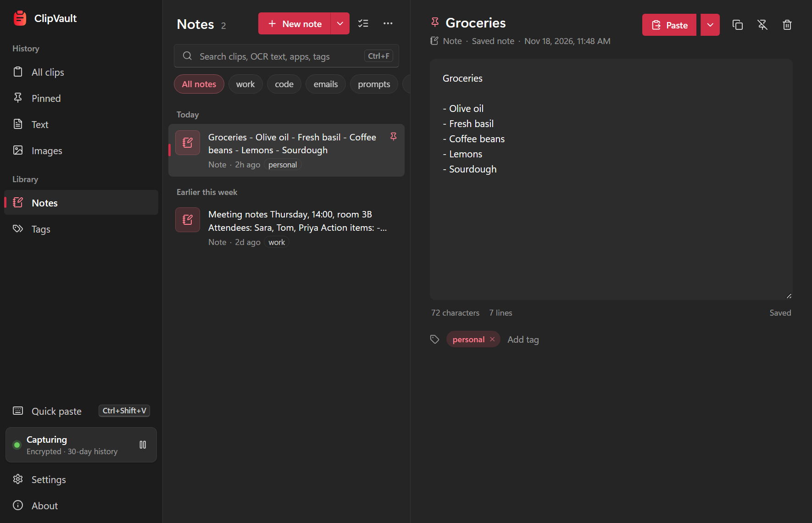
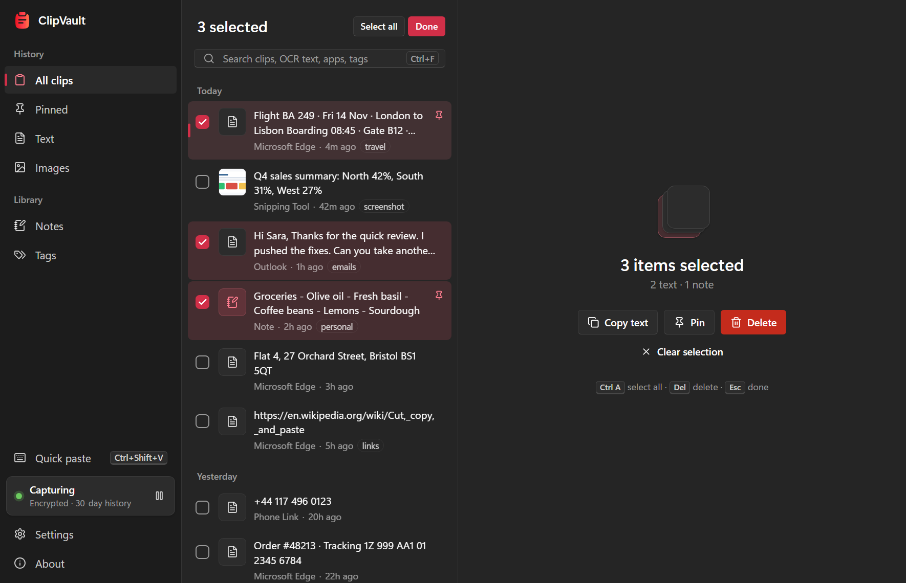
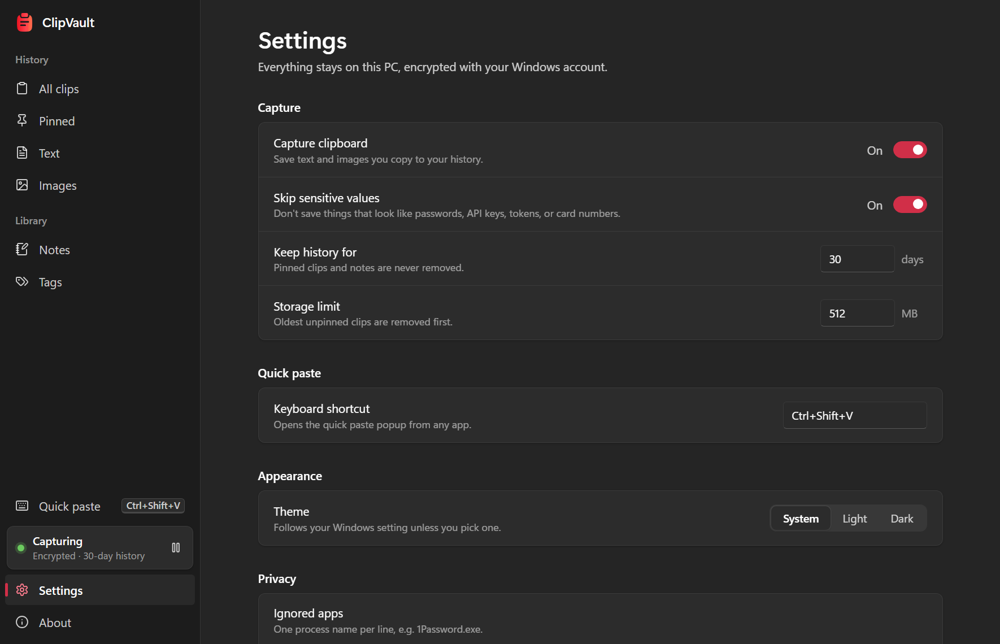

<div align="center">



# ClipVault

**Windows only remembers the last thing you copied. ClipVault remembers everything, and keeps it private.**

[](https://github.com/AMIRSRAD/ClipVault/releases/latest)   

[**Part 1: For everyone**](#part-1-for-everyone) &nbsp;·&nbsp; [**Part 2: How it works**](#part-2-how-it-works-technical) &nbsp;·&nbsp; [**Part 3: Build it yourself**](#part-3-getting-started-and-building)

<br>



</div>

<br>

---

# Part 1: For everyone

*No technical knowledge needed. If you just want to use ClipVault, this is the only part you need.*

## What is ClipVault?

Every time you copy something on your computer (a sentence, a link, an address, a picture), Windows puts it on a hidden shelf called the **clipboard**. The catch: the shelf holds **only one thing**. Copy something new and the old one is gone.

**ClipVault fixes that.** It quietly remembers everything you copy, so you can bring any of it back later: the address you copied yesterday, the link from this morning, the screenshot you took an hour ago. Press one shortcut, pick what you want, and it is pasted right where you are typing.

It lives in the background (look for the small icon near the clock), uses very little battery or memory, and **everything stays on your own PC, locked with encryption.** There is no account, no cloud, and no tracking. **ClipVault is free for everyone to use**, at home or at work.

## What can I do with it?

| | |
| --- | --- |
| **Never lose a copy** | Text and images you copy are saved automatically and kept for 30 days (you can change that). |
| **Paste from anywhere** | Press `Ctrl` + `Shift` + `V` in any app to open a small popup, then click what you want. |
| **Paste several things at once** | Tick a few items in the popup and paste them all in one go, in the order you picked. |
| **Find anything fast** | Search by words, app name, or tag. It even finds text inside screenshots. |
| **Keep the things you reuse** | Pin items so they never expire, or write your own notes and templates (meeting notes, to-do lists, email replies). |
| **Tidy up as you paste** | Paste as plain text, one line, UPPERCASE, Title Case, or neatly formatted JSON. |
| **Stay in control** | Pause it any time, delete one item or everything, and tell it to ignore certain apps. |

## Download and install

You need **Windows 10 or 11 (64-bit)**. You do **not** need an administrator password.

1. Open the **[latest release page](https://github.com/AMIRSRAD/ClipVault/releases/latest)**.
2. Under **Assets**, click **`ClipVault_1.4.0_x64-setup.exe`** to download it.
3. Open the downloaded file.
   - Windows may show a blue box saying *"Windows protected your PC"*. That happens for any newer program that isn't from a big publisher. Click **More info**, then **Run anyway**.
4. Click through the installer. Two questions are worth a look:
   - **Create a desktop shortcut?** Optional.
   - **Start ClipVault when you sign in to Windows?** We recommend **Yes**. ClipVault can only remember what you copy while it is running, and it starts quietly in the background.
5. Finished. Look for the ClipVault icon in the system tray (bottom-right of the screen, near the clock; it may be behind the small `^` arrow).

**Updating** is automatic and quiet; see [Updates](#updates). **Uninstalling:** open **Settings → Apps → Installed apps**, find **ClipVault**, and choose **Uninstall**. You can tick a box to delete your saved history too.

## A quick tour

### Your history, always searchable

Everything you copy appears in one list (see the screenshot at the top), grouped by day, with a preview of the selected item on the right. Click an item to see it in full, copy it again, paste it, pin it, tag it, or delete it. Images show a thumbnail, and for screenshots you can pull out the text with one click. Smart suggestions appear when they make sense: open a link, format JSON, or open a file's folder.

### Paste from anywhere with one shortcut

Press **`Ctrl` + `Shift` + `V`** in any app. A small popup appears at the bottom of the screen with your most recent items. Type to search, use the arrow keys, and press **Enter** (or just click) to paste into whatever you were typing in. Press **Esc** to close it.

<p align="center">
  
  &nbsp;&nbsp;
  
</p>

ClipVault follows your Windows **light or dark** setting automatically. Prefer one or the other? Choose **System, Light, or Dark** under **Settings → Appearance**.

<p align="center">
  
</p>

### Paste several things at once

Need to paste three things into one email? Hover over an item and tick its box (or press **Space**) to select it. Select as many as you like, then press **Enter** or click **Paste**. They are pasted together in the order you picked them, with a new line between each (you can switch that to a space, comma, or blank line with **Join**).

<p align="center">
  
</p>

Pictures can't be joined into text, so they are greyed out while you are selecting.

### Notes you can reuse

Save things you paste again and again: a standard email reply, an address, a checklist. Notes never expire. Start from a template (meeting notes, to-do list, code snippet, prompt, email reply) or from a blank page, and group them with tags such as *work*, *emails*, or *personal*.

<p align="center">
  
</p>

### Select, pin, and clean up

Click the checklist button above the list (or hold **Ctrl** / **Shift** while clicking) to select many items at once. You can then copy their text, pin them, or delete them together. The **…** menu has **Clear history**, which asks first and lets you keep pinned items and notes.

<p align="center">
  
</p>

### Settings you actually understand

Choose how long to keep history, which apps to ignore, the shortcut, the theme, and whether ClipVault starts with Windows. Every setting has a plain-English description.

<p align="center">
  
</p>

## Keyboard cheat sheet

**Anywhere in Windows**

| Keys | What it does |
| --- | --- |
| `Ctrl` `Shift` `V` | Open the quick paste popup (you can change this in Settings) |

**In the quick paste popup**

| Keys | What it does |
| --- | --- |
| `↑` `↓` | Move through the list |
| `Enter` | Paste the highlighted item (or all selected items) |
| `Space` | Select / unselect the highlighted item for multi-paste |
| `Shift` + `↑` `↓` | Select a run of items |
| `Ctrl` + `C` | Copy the highlighted item (or all selected items) without pasting |
| `Ctrl` + `P` | Pin / unpin |
| `Delete` | Remove the highlighted item |
| `Tab` or `Alt` + `1`…`5` | Switch between All, Text, Images, Notes, Pinned |
| `Esc` | Clear the selection, then clear the search, then close |
| Right-click | More options, including **Paste as…** |

**In the main window**

| Keys | What it does |
| --- | --- |
| `Ctrl` `F` | Search |
| `Enter` / `P` / `Delete` | Paste / pin / delete the selected item |
| `Ctrl` `A` | Select everything shown |
| `Ctrl` / `Shift` + click | Select several items (Shift selects a range) |
| `Ctrl` `N` | New note |

## Privacy and safety

- **It stays on your PC.** Your history is never uploaded anywhere. There is no account, no cloud, and no tracking.
- **It is encrypted.** Your history is stored in an encrypted file that is locked to your Windows account. Another person (or another Windows user on the same PC) can't read it.
- **It skips sensitive things.** By default ClipVault does not save text that looks like a password, API key, access token, private key, or card number. It also respects password managers that mark what they copy as private, and you can tell it to ignore specific apps or window titles.
- **You are in control.** Pause capture with one click (sidebar or tray icon), delete any item, or clear everything. History is automatically removed after 30 days (pinned items and notes are kept), and you can change that.
- **The only internet use** is a small once-a-day check on GitHub to see whether a newer version exists. You can turn it off.

## Updates

ClipVault keeps itself up to date without getting in your way:

- Once a day it checks GitHub for a newer version. If there is one, it is downloaded quietly in the background and checked to make sure it really came from the author.
- You are **never interrupted**: no pop-ups, no sounds, no notifications. A small **Update ready** card appears at the bottom of the sidebar. Click **Restart** when it suits you, or ignore it.
- **Settings → Updates** lets you check right now or turn automatic downloads off. Your history is never touched by an update.

## Frequently asked questions

**Does it remember things when it is closed?**
No. ClipVault only saves what you copy while it is running. That is why starting it with Windows is recommended.

**Where is my data stored?**
In `%LOCALAPPDATA%\ClipVault\ClipVault\data` on your PC (paste that into the File Explorer address bar to open it). Uninstalling can remove it for you.

**Will it slow my computer down?**
No. When you aren't copying anything it does nothing at all (no background polling) and it stays small in memory, roughly the same as a single browser tab.

**I copied a password and it isn't in my history. Is something wrong?**
No, that is on purpose. See [Privacy and safety](#privacy-and-safety). You can switch this off in **Settings → Capture → Skip sensitive values**.

**How do I stop it saving something for a moment?**
Click the pause button in the sidebar (or choose **Pause capture** from the tray icon). Anything you copy while paused is skipped, even after you resume.

**Can I use it on Mac, Linux, or my phone?**
Not yet. ClipVault is Windows-only for now.

**Windows showed a warning when I installed it.**
That is Windows being cautious about newer programs without a paid publisher certificate. Choose **More info → Run anyway**.

**It didn't start with Windows.**
Open **Settings → Window** inside ClipVault and switch on **Launch on Windows startup**.

---

# Part 2: How it works (technical)

*For developers, reviewers, and the curious. The deeper reference is in [`docs/ARCHITECTURE.md`](docs/ARCHITECTURE.md).*

## Overview

ClipVault is a Windows-first desktop app built with **Tauri 2**. Rust owns everything that touches the operating system or disk; a React single-page app renders two windows (the main window and the quick paste popup) inside WebView2.

```
 ┌──────────────────────── WebView2 (one webview per window) ────────────────────────┐
 │   Main window  (src/App.tsx + components)     Quick paste popup  (QuickPaste.tsx) │
 └───────────────────────────────▲───────────────────────────────▲───────────────────┘
                                 │  invoke() commands  +  events (Tauri IPC)
 ┌───────────────────────────────┴───────────────────────────────┴───────────────────┐
 │ Rust backend                                                                       │
 │  clipboard.rs   storage.rs   privacy.rs   crypto.rs   ocr.rs   updater.rs   main.rs│
 └──────┬───────────────┬──────────────────┬───────────────┬──────────────┬──────────┘
        │ Win32         │ SQLCipher        │ DPAPI         │ WinRT OCR    │ HTTPS
  clipboard listener  encrypted SQLite   key protection  Windows.Media.Ocr  GitHub Releases
  SendInput (paste)   + FTS5 search      for key + backups                  (signed updates)
```

## Tech stack

| Layer | Technology | Notes |
| --- | --- | --- |
| App shell | Tauri 2 | Small native shell, tray icon, single-instance, global shortcut, updater plugins |
| Backend | Rust (2021 edition) | `windows` crate for Win32/WinRT, `arboard` for clipboard data, `image` for PNG/thumbnail encoding |
| Frontend | React 18, TypeScript, Vite 5 | No UI framework; hand-written Fluent-style CSS with light/dark design tokens |
| Storage | SQLite via `rusqlite` + SQLCipher | Vendored OpenSSL; FTS5 for search |
| Key protection | Windows DPAPI | Key and backup payloads are bound to the Windows user |
| OCR | `Windows.Media.Ocr` | Local, on demand, no model downloads |
| Updates | `tauri-plugin-updater` + minisign | Signed releases from GitHub |
| Installer | NSIS (per-user) and MSI | WebView2 bootstrapper embedded |
| CI | GitHub Actions (Windows) | Build, rustfmt, clippy, tests |

## Capturing the clipboard

1. A dedicated thread owns a message-only window registered with `AddClipboardFormatListener` and blocks in `GetMessageW`. When the clipboard changes Windows posts `WM_CLIPBOARDUPDATE`; between changes the thread is asleep (zero wakeups).
2. It waits 120 ms for the source app to finish writing, collapses bursts into one event, then compares `GetClipboardSequenceNumber()` with the last seen value. If the listener can't be registered it falls back to a 650 ms sequence-number poll.
3. Capture is skipped when capture is paused (the change is still recorded, so nothing copied during a pause appears on resume), when the source app or window title is on the ignore list, when the clipboard carries `ExcludeClipboardContentFromMonitorProcessing` (set by password managers), when the content is too large (512 KB of text, 8 MB of image), or when it looks sensitive.
4. Surviving content is normalised and hashed with SHA-256 for de-duplication. Images are encoded to PNG with a thumbnail (up to 420×260). Everything is written to the encrypted database and added to the full-text index.

"Looks sensitive" covers private-key blocks, `password=` / `token: …` / JSON-style secrets, well-known token prefixes (`ghp_`, `sk-`, `AKIA`, …), JWTs, bearer tokens, Luhn-valid card numbers, and long random strings. Details and tests live in `src-tauri/src/privacy.rs`.

## Pasting

Paste (`paste_item`, `paste_text`) remembers the foreground window before the popup opened, briefly pauses capture so ClipVault doesn't record its own paste, places the content on the clipboard, restores focus to the target, sends `Ctrl+V` with `SendInput`, then restores the previous text or image clipboard on a best-effort basis. Multi-paste in the popup joins the selected text in the browser and sends one `paste_text` call.

## Data and encryption

- One SQLCipher database (`clipvault.db`, WAL mode) under `%LOCALAPPDATA%\ClipVault\ClipVault\data`.
- Tables: `clipboard_items` (text, images, notes), `items_fts` (FTS5 index over text, OCR text, tags, source app and title), `tags`, `item_tags`, `settings`.
- The database key is 32 bytes from the OS random number generator, protected with Windows DPAPI for the current user and stored beside the database. Existing keys keep working across upgrades.
- Retention pruning removes expired, unpinned captures (and enforces the storage cap); notes and pinned items are exempt.
- Bulk delete, pin and "clear history" run in single transactions; clearing also checkpoints the WAL and runs `VACUUM` so deleted clips don't linger in the file.
- Backups export settings, notes and pinned clips as a `clipvault-dpapi-v1:` payload protected with DPAPI, so they restore only for the same Windows user.

## Windows integration

Global shortcut (default `Ctrl+Shift+V`), tray menu (open, quick paste, settings, pause/resume, quit), single-instance relaunch, close-to-tray and minimize-to-tray, optional launch at sign-in through the per-user `Run` key (`--minimized` starts hidden in the tray), native dragging of the popup, and ShellExecute for opening links and paths.

The popup window is undecorated with `shadow: true`, which gives it native Windows 11 rounded corners, border and shadow. Its Tauri capability set is intentionally smaller than the main window's.

## Performance

ClipVault is designed to be invisible while idle. Measured on Windows 11 with the app hidden in the tray:

| Metric | Result |
| --- | --- |
| Wakeups per second (all processes) | 0 |
| CPU | ≈ 0.05 % |
| Total working set (ClipVault + WebView2) | ≈ 55–95 MB |
| Quick paste popup appears | 3–14 ms |

How: event-driven clipboard listener (no polling), both windows stay loaded so the popup is instant, hidden windows switch WebView2 to its low-memory mode (`ICoreWebView2_19::SetMemoryUsageTargetLevel`) and are restored right before being shown, and the update check is a sleeping 24-hour timer.

## Auto-update and signing

`tauri-plugin-updater` fetches `releases/latest/download/latest.json` (a manifest with the version, notes, installer URL and minisign signature). A background task checks 60 s after launch and then every 24 h, downloads a newer installer into memory, verifies its signature against the public key compiled into the app, and surfaces an "Update ready" card. The installer only runs when the user clicks **Restart** (NSIS passive mode, which relaunches the app). The private signing key never lives in the repository. See [`docs/RELEASE_CHECKLIST.md`](docs/RELEASE_CHECKLIST.md).

## Repository layout

```
src/                     React frontend
  App.tsx                window mode + main shell state
  components/            Sidebar, ClipList, DetailPanel, BulkPanel, QuickPaste, SettingsPanel, ConfirmDialog
  lib/clip.ts            pure helpers: formatting, detection, paste transforms, fuzzy search
  api.ts, types.ts       typed wrappers over Tauri commands (+ browser demo fallbacks)
  mockData.ts            sample data for running the UI without Tauri
  styles.css             design tokens (light/dark) and all styles
src-tauri/               Rust backend
  src/                   clipboard, storage, privacy, crypto, ocr, updater, webview_memory, commands, main
  capabilities/          per-window Tauri permissions
  windows/               NSIS hooks and installer artwork
  tauri.conf.json        windows, bundle, installer, and updater configuration
scripts/                 make-update-manifest.mjs (builds latest.json for releases)
docs/                    ARCHITECTURE.md, RELEASE_CHECKLIST.md, screenshots
.github/workflows/       CI
```

---

# Part 3: Getting started and building

> **A note on the license.** ClipVault is free to use, and the source is published so anyone can read it, check what it does, and build it for their own use. Distributing modified versions or reselling it needs the author's written permission. The full terms are in [`LICENSE`](LICENSE).

## What you need

| Tool | Version / notes |
| --- | --- |
| Windows | 10 or 11 (64-bit) |
| Node.js | 20 or newer |
| pnpm | 10.16.1 (run `corepack enable` and it picks the pinned version from `package.json`) |
| Rust | stable, installed with [rustup](https://rustup.rs) |
| Microsoft C++ Build Tools | "Desktop development with C++" workload |
| WebView2 runtime | Already on Windows 11 and current Windows 10 |
| Strawberry Perl | Needed to compile the vendored OpenSSL behind SQLCipher |

> **Perl gotcha:** put `C:\Strawberry\perl\bin` **before** Git's Perl in `PATH`. Git for Windows ships a Cygwin Perl that cannot configure OpenSSL, and the build fails with `Configure` errors. In PowerShell:
>
> ```powershell
> $env:Path = "C:\Strawberry\perl\bin;C:\Strawberry\c\bin;$env:USERPROFILE\.cargo\bin;$env:Path"
> ```

## Get the code and install dependencies

```powershell
git clone https://github.com/AMIRSRAD/ClipVault.git
cd ClipVault
corepack enable
pnpm install --frozen-lockfile
```

## Run it

**Just the interface in a browser** (fast; uses built-in sample data, no Windows features):

```powershell
pnpm dev
```

Open <http://localhost:1420>. Add `?palette` to the address to see the quick paste popup, `?view=notes` / `?view=settings` to jump to a page, `?theme=light` or `?theme=dark` to force a theme, and `?select=0,2,3` to open with those rows ticked.

**The full desktop app** (real clipboard, tray, shortcut, encryption):

```powershell
pnpm tauri dev
```

The first run compiles the Rust backend and takes several minutes; later runs are fast.

## Build the installers

```powershell
pnpm tauri build
```

Outputs:

- `src-tauri/target/release/clipvault.exe`
- `src-tauri/target/release/bundle/nsis/ClipVault_<version>_x64-setup.exe` (per-user installer)
- `src-tauri/target/release/bundle/msi/ClipVault_<version>_x64_en-US.msi`

`createUpdaterArtifacts` is on, so the build also produces `.sig` files. That requires the signing key in two environment variables, and the build stops with a clear error without them:

```powershell
$env:TAURI_SIGNING_PRIVATE_KEY = Get-Content "path\to\clipvault.key" -Raw
$env:TAURI_SIGNING_PRIVATE_KEY_PASSWORD = "your key password"
```

To try a build without release signing, turn that off for the one build (PowerShell needs the inner quotes escaped):

```powershell
pnpm tauri build --config '{\"bundle\":{\"createUpdaterArtifacts\":false}}'
```

## Check your changes

```powershell
pnpm build                                   # TypeScript check + production frontend build
cargo test   --manifest-path src-tauri/Cargo.toml
cargo fmt    --manifest-path src-tauri/Cargo.toml --check
cargo clippy --manifest-path src-tauri/Cargo.toml -- -D warnings
```

The same checks run in GitHub Actions on every push and pull request.

## Cutting a release

Releases are signed and published as GitHub releases with a `latest.json` manifest. The step-by-step process, including the smoke-test list, is in [`docs/RELEASE_CHECKLIST.md`](docs/RELEASE_CHECKLIST.md).

## Roadmap

- Clipboard restore after paste for more content formats.
- Export/import refinements and cross-machine backup options.
- Optional Tesseract OCR fallback.
- End-to-end encrypted PC/Android sync, keeping Android clipboard limits in mind.

## Creator and license

- Creator: **Amirsalar Saberi rad** · [amirsrad.ir](https://amirsrad.ir)
- License: **free to use** (personal or commercial), source available for review and personal builds; modified redistribution and resale need permission. Copyright © 2026 Amirsalar Saberi rad. See [`LICENSE`](LICENSE).

Screenshots in this README use sample data.
