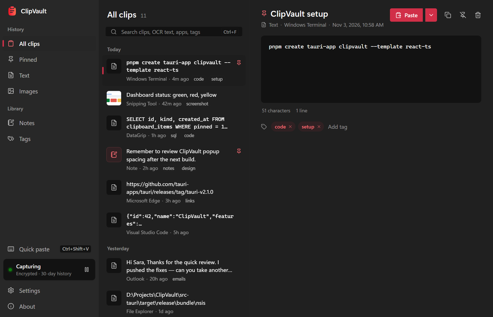
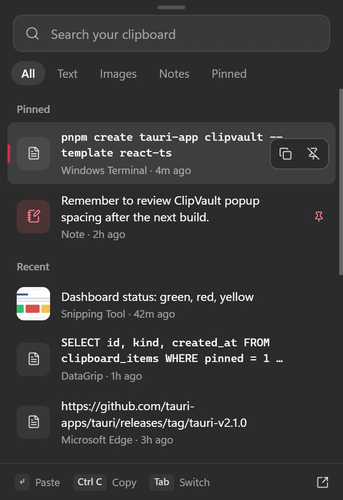

# ClipVault

[](https://github.com/AMIRSRAD/ClipVault/releases/latest) 

ClipVault is a modern lightweight Windows clipboard manager with encrypted local history, saved note snippets, OCR, smart preview actions, and a fast Windows-style quick-paste popup.

It captures text and images, gives you a fast `Ctrl+Shift+V` quick paste popup, lets you save reusable notes/snippets, and keeps all content local.

## Screenshots



<p align="center">
  
</p>

Screenshots use sample data. The interface follows your Windows light/dark setting.

## Features

- Text and image clipboard history.
- Searchable timeline with source metadata, tags, pins, and SQLite FTS indexing.
- Windows 11 (Fluent) style interface that follows the system light/dark theme.
- A minimal quick paste popup: search first, light section tabs, a flat list with image thumbnails, hover actions, right-click paste-as options, and pinned items on top. It opens as a native rounded Windows 11 flyout at the bottom center of your screen.
- Keyboard-first: `↑`/`↓` to move, `Enter` to paste, `Ctrl+C` to copy, `Ctrl+P` to pin, `Tab` or `Alt+1-5` to switch sections in quick paste; `Ctrl+F` to search, `P` to pin, `Delete` to remove, `Ctrl+A` to select all, and `Ctrl+N` for a new note in the main window.
- Select multiple items (the checklist button, or Ctrl/Shift-click) to pin, copy, or delete them together; Shift-click selects a range and `Ctrl+A` selects everything shown.
- Clear your history in one step from the list's **...** menu or **Settings -> Backup & data**, with the choice to keep pinned clips and notes. Cleared clips are also compacted out of the database file.
- Default global shortcut: `Ctrl+Shift+V`.
- Quiet automatic updates: ClipVault checks once a day, downloads signed updates in the background, and only shows a small "Update ready" card in the sidebar. Nothing is installed until you click Restart, and it can be turned off in Settings.
- System tray menu for opening ClipVault, opening quick paste, pausing/resuming capture, opening Settings, and quitting.
- Window behavior settings for close-to-tray, minimize-to-tray, start minimized, and launch on Windows startup (starts hidden in the tray).
- Polished Windows window behavior with no console window, tray-first close/minimize support, and stable reopen behavior.
- Dedicated Info tab for creator, website, and license ownership details.
- Notes as saved snippets, stored in the same encrypted item system as clipboard entries.
- Saved snippet collections backed by tags: work, code, emails, prompts, and personal.
- Favorite note templates: meeting note, todo, code snippet, prompt, and email reply.
- On-demand local OCR for copied screenshots and image clips using Windows native OCR APIs.
- Smart preview actions for detected content:
  - open URL
  - copy domain
  - format JSON
  - beautify code
  - extract emails
  - open Windows file path
- Paste transformations for text: plain, trim, no line breaks, upper/lower/title case, JSON prettify, and JSON minify.
- Privacy controls for capture pause/resume (sidebar or tray), excluded apps/window titles, sensitive-value suppression, and retention.
- Clipboard restore after quick paste for text and images when the prior clipboard content can be read.
- Encrypted import/export for settings, notes, and pinned clips.
- Custom app icon for the title bar, taskbar, tray, installer, and in-app branding.

## Tech Stack

- Tauri 2
- React 18
- TypeScript
- Vite
- Rust
- SQLite with SQLCipher
- Windows DPAPI for protecting local encryption material and backup payloads
- Windows clipboard, global shortcut, paste simulation, and OCR integrations

## Creator And License

- Creator: Amirsalar Saberi rad
- Website: [amirsrad.ir](https://amirsrad.ir)
- License: Copyright Amirsalar Saberi rad. All rights reserved.

The repository includes a root `LICENSE` file with the same all-rights-reserved ownership notice.

## Requirements

- Windows 10/11.
- Node.js 20+.
- pnpm 10.16.1 (Corepack reads the pinned version from `package.json`).
- Rust and Cargo through rustup.
- Microsoft C++ Build Tools.
- Microsoft Edge WebView2 runtime.
- Strawberry Perl, used by the vendored OpenSSL build for SQLCipher. Put `C:\Strawberry\perl\bin` before Git's Perl in `PATH`; Git's Cygwin Perl fails to build OpenSSL.

## Install

Download `ClipVault_1.2.0_x64-setup.exe` from the [latest release](https://github.com/AMIRSRAD/ClipVault/releases/latest) and run it. No administrator rights are needed; it installs for the current Windows user.

The installer:

- Shows the license, lets you pick the install folder (default `%LOCALAPPDATA%\ClipVault`), and installs the WebView2 runtime if your PC doesn't have it.
- Creates a Start Menu shortcut. On the last page you can tick **Create a desktop shortcut** and **Run ClipVault**.
- Asks whether to start ClipVault when you sign in to Windows. If you say yes, it starts quietly in the system tray.
- Registers ClipVault in **Settings → Apps → Installed apps** so Windows can uninstall it. The uninstaller can also delete your saved history and key.

Upgrading is just running a newer installer (or clicking **Restart** on the in-app update card); your history, notes, and settings are kept.

You can change startup behavior any time in **Settings → Window → Launch on Windows startup**. The installer is unsigned, so Windows SmartScreen may show a reputation warning; choose **More info → Run anyway**. An MSI is also published for managed deployments.

### Silent install

```powershell
.\ClipVault_1.2.0_x64-setup.exe /S
.\ClipVault_1.2.0_x64-setup.exe /S /D=D:\Apps\ClipVault   # custom folder; /D must be last
```

Silent installs create the Start Menu and desktop shortcuts and do not enable startup.

### Build from source

```powershell
corepack enable
pnpm install --frozen-lockfile
```

## Development

Run the frontend only:

```powershell
pnpm dev
```

Run the full Tauri desktop app:

```powershell
pnpm tauri dev
```

## Build

```powershell
pnpm build
pnpm tauri build
```

Release outputs are generated under:

- `src-tauri/target/release/clipvault.exe`
- `src-tauri/target/release/bundle/nsis/ClipVault_1.2.0_x64-setup.exe`
- `src-tauri/target/release/bundle/msi/ClipVault_1.2.0_x64_en-US.msi`

The app icon is generated from:

- `src-tauri/icons/icon-source.png`
- `src-tauri/icons/icon.ico`
- `src/assets/clipvault-icon.png`

## Verification

Use these before cutting a Windows release:

```powershell
pnpm build
cargo test --manifest-path src-tauri/Cargo.toml
cargo fmt --manifest-path src-tauri/Cargo.toml --check
cargo clippy --manifest-path src-tauri/Cargo.toml -- -D warnings
pnpm tauri build
```

If Cargo or native dependencies are not on PATH in PowerShell, prepend the local toolchain paths first:

```powershell
$env:Path = "$env:USERPROFILE\.cargo\bin;C:\Strawberry\perl\bin;C:\Strawberry\c\bin;C:\Strawberry\perl\site\bin;$env:Path"
```

## Updates

ClipVault updates itself without getting in the way:

- Once a day (and a minute after launch) it asks GitHub for the latest release. The check is a single small request and is skipped if you turn off **Settings -> Updates -> Download updates automatically**.
- If a newer version exists, it is downloaded in the background and its signature is verified against the public key built into the app. Updates that aren't signed by the maintainer are rejected.
- You are never interrupted: no pop-ups, no sounds, no tray notifications. A small **Update ready** card appears in the sidebar; click **Restart** when it suits you, or dismiss it. **Settings** and **About** also have a **Check now** button.
- Installing shows a short progress window, then ClipVault reopens. Your history is untouched.

## Performance

ClipVault is built to sit in the system tray all day without costing you anything:

- **Zero idle CPU.** The clipboard is watched through the Windows clipboard listener instead of polling, so the app sleeps until you actually copy something (0 wakeups per second when idle, about 0.05% CPU for the whole process tree).
- **Low idle memory.** While a window is hidden, its web view is switched to WebView2's low-memory mode, which trims it to roughly 55-95 MB total in the tray (about 550 MB before 1.0.1). The normal level is restored when a window is shown.
- **Instant quick paste.** Both windows stay loaded, so `Ctrl+Shift+V` shows the popup in a few milliseconds even after hours in the tray.
- **Nothing else runs in the background** besides the clipboard listener and the once-a-day update check (a sleeping timer, so no idle wakeups). No telemetry.

## Roadmap

- Clipboard restore after paste for more content formats.
- Tray menu polish.
- Export/import UX refinements and cross-machine backup options.
- Optional Tesseract OCR fallback.
- End-to-end encrypted PC/Android sync, keeping Android clipboard platform limits in mind.
